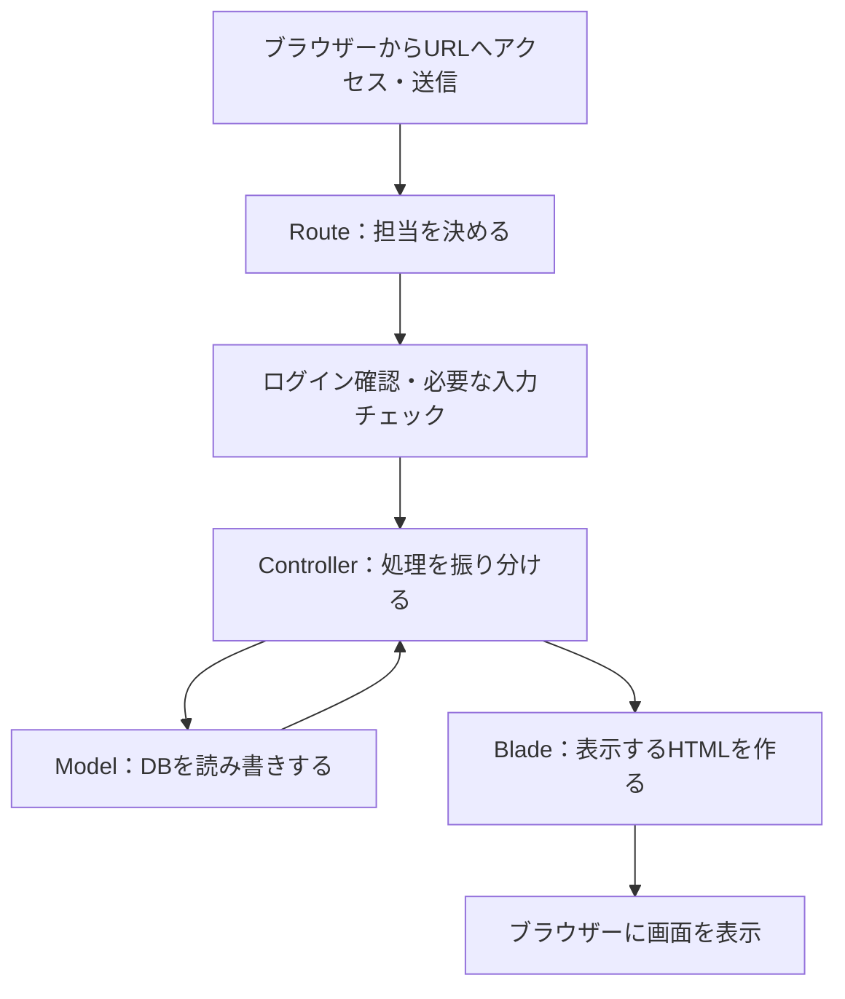

# 初心者向け：コードを読む順番の手順書

この手順書では、Cytech ECのコードを「画面で何をすると、どのファイルが動くか」の順に読んでいきます。前回追加した日本語コメントと一緒に使ってください。

最初の目標は、**商品一覧が表示されるまでの流れを、自分の言葉で説明できること**です。初日は手順1〜3だけでも十分です。知らない書き方が出てきても、その場ですべて覚える必要はありません。

## まず決めておく読み方

1. 今から調べる操作を1つ決めます。例：「商品一覧を開く」。
2. 下の手順に沿って、指定されたファイルと関数だけを読みます。
3. 「受け取るもの」「行うこと」「返すもの」を短くメモします。
4. 各手順の確認問題に答えられたら、次へ進みます。

ファイルを上から最後まで一気に読む必要はありません。特に`Product.php`は複数の機能をまとめているため、指定された関数へ移動して読んでください。

ここにあるファイルへのリンクは、この手順書の置き場所を基準にしています。エディターでリンクを開くか、プロジェクト内のファイル検索で同じ名前を探してください。

## 手順1：アプリ全体の地図をつかむ

最初に[README](../README.md)の冒頭と「主な操作と仕様」を読みます。商品を登録する人と、商品を購入する人がいるアプリだと分かれば十分です。環境構築のコマンドは、この段階では実行不要です。

次に、次の役割分担を見ます。

| 場所 | 役割 | 身近な例 |
|---|---|---|
| `routes/` | URLと担当する処理を結び付ける | 学校の受付の案内表 |
| `app/Http/Requests/` | 入力内容や操作できる人を確認する | 提出物のチェック係 |
| `app/Http/Controllers/` | 必要な処理を呼び、結果を返す | 作業を振り分ける係 |
| `app/Models/` | DBから情報を探したり保存したりする | 記録帳を管理する係 |
| `resources/views/` | 受け取った情報から画面を作る | 掲示物を作る係 |
| `resources/js/` | クリックや通信など、ブラウザー側の動きを作る | 画面の操作係 |
| `resources/css/` | 色・余白・配置を決める | 見た目のデザイン係 |
| `tests/` | 期待した動作になっているか確認する | 自動で採点する確認問題 |

DB（データベース）は、利用者や商品などの情報を保存する場所です。ブラウザーは画面を表示するアプリで、サーバーは入力を受け取り、DBの操作や画面の作成を行う側です。

基本の流れは次のとおりです。



これは基本形です。DBを使わない画面もあり、APIやJavaScriptへの返事では画面全体の代わりにデータを返します。

**確認問題：入力をチェックする場所と、DBへ保存する場所は、それぞれどこでしょうか？**

## 手順2：商品一覧のURLから担当処理を見つける

開くファイル：[routes/web.php](../routes/web.php)

`/products`を検索して、次の行を見つけます。

```php
Route::get('/products', [ProductController::class, 'index'])->name('products.index');
```

| 書き方 | この行での意味 |
|---|---|
| `get` | 画面や情報を取得するためのアクセス |
| `/products` | アクセス先のURLのパス |
| `ProductController::class` | 担当するクラス。クラスは関係する処理をまとめたもの |
| `'index'` | 呼び出す関数名。クラスの中の関数は「メソッド」とも呼ぶ |
| `name('products.index')` | リンクを作るときに使える、このルートの名前 |

この行を囲んでいる`Route::middleware('auth')`にも注目します。`auth`は、ログインしていない人をログイン画面へ案内する確認処理です。

**確認問題：商品一覧を開くと、どのクラスのどの関数が呼ばれるでしょうか？**

## 手順3：商品一覧ができるまでを追う

次の順に開きます。

1. [ProductController.php](../app/Http/Controllers/ProductController.php)の`index()`
2. [SearchProductRequest.php](../app/Http/Requests/SearchProductRequest.php)の`rules()`
3. [Product.php](../app/Models/Product.php)の`getListedProductsForUser()`
4. [products/index.blade.php](../resources/views/products/index.blade.php)
5. [products/product_list.blade.php](../resources/views/products/product_list.blade.php)

読みやすくするため、まずControllerで全体を見てからRequestへ戻ります。実際の実行時は、Requestの入力チェックが成功してからControllerの`index()`の中へ進みます。

`index()`では、最初は次の3か所に注目してください。`expectsJson()`の分岐は手順6で読みます。

```php
$filters = $request->validated();
$products = Product::getListedProductsForUser($request->user()->id, $filters);
return view('products.index', ['products' => $products, 'filters' => $filters]);
```

これはコードの一部を抜き出したものです。意味は「チェック済みの検索条件を受け取る → 商品を探す → 商品と検索条件を画面へ渡す」です。

`$filters`や`$products`は、値を入れておく変数です。`->`は、そのデータが持つ情報や処理へ進む書き方です。`view('products.index')`は、`resources/views/products/index.blade.php`を使って画面を作る、という指定です。

Modelでは、まず「自分の商品を除く」「商品番号順に並べる」「結果を取り出す」の3点を探します。名前や価格の絞り込みは手順6で詳しく読みます。

Bladeでは`@include('products.product_list')`を探します。これは商品一覧の表だけを別ファイルから組み込む指定です。その先の`@foreach`が、商品を1件ずつ表の行にしています。

**確認問題：Controllerの`$products`は、どこで作られ、どのファイルで表の行になるでしょうか？**

## 手順4：共通の画面部品とデザインを読む

次の順に開きます。

1. [products/index.blade.php](../resources/views/products/index.blade.php)の`<x-app-layout>`
2. [AppLayout.php](../app/View/Components/AppLayout.php)の`render()`
3. [layouts/app.blade.php](../resources/views/layouts/app.blade.php)
4. [site_header.blade.php](../resources/views/components/site_header.blade.php)と[site_footer.blade.php](../resources/views/components/site_footer.blade.php)
5. [product_image.blade.php](../resources/views/components/product_image.blade.php)と[product_price.blade.php](../resources/views/components/product_price.blade.php)
6. [app.css](../resources/css/app.css)

`<x-...>`は、繰り返し使う画面部品です。外枠の`{{ $slot }}`へ各画面の中身を入れることで、同じヘッダーやフッターを共有できます。

CSSは全行を読むより、Bladeで見つけたクラス名を1つ検索するのがおすすめです。例えば`product-table__price`を探すと、金額欄の見た目の指定が見つかります。`@media`は、画面幅などに応じて配置を変える指定です。

**確認問題：全画面共通のフッターを調べるなら、どのファイルを見るでしょうか？**

## 手順5：ログインと利用者登録を読む

次の2つの流れを、別々に追います。

| 操作 | 読む順番 |
|---|---|
| ログイン | [routes/auth.php](../routes/auth.php) → [auth/login.blade.php](../resources/views/auth/login.blade.php) → [LoginRequest.php](../app/Http/Requests/Auth/LoginRequest.php) → [AuthenticatedSessionController.php](../app/Http/Controllers/Auth/AuthenticatedSessionController.php)の`store()` |
| 利用者登録 | [auth/register.blade.php](../resources/views/auth/register.blade.php) → [RegisterRequest.php](../app/Http/Requests/Auth/RegisterRequest.php) → [RegisteredUserController.php](../app/Http/Controllers/Auth/RegisteredUserController.php)の`store()` → [User.php](../app/Models/User.php)の`registerUser()`と`casts()` |

フォームでは`action`（送信先）と`name`（項目の名前）を見ます。同じ項目名をRequestの`rules()`で探すと、入力欄と入力条件がつながります。

`required`は必須、`max`は上限、`confirmed`は確認用の入力と同じかを調べる指定です。ログインでは、形のチェックをする`rules()`と、本当に登録情報と一致するか調べる`authenticate()`の役割の違いを見ます。

登録後は自動ログインせず、ログイン画面へ戻ります。パスワードを保存するときの`hashed`は、元の文字列へ戻せない形に変換する指定です。

**確認問題：「入力されているか」と「パスワードが合っているか」は、どの処理で確認するでしょうか？**

## 手順6：画面を読み直さない商品検索を読む

次の順に開きます。

1. [products/index.blade.php](../resources/views/products/index.blade.php)の検索フォームと`data-search-results`
2. [app.js](../resources/js/app.js)の`initializeProductSearch()`呼び出し
3. [product_search.js](../resources/js/product_search.js)
4. [SearchProductRequest.php](../app/Http/Requests/SearchProductRequest.php)の`rules()`と`after()`
5. [ProductController.php](../app/Http/Controllers/ProductController.php)の`index()`にある`expectsJson()`の分岐
6. [Product.php](../app/Models/Product.php)の`getListedProductsForUser()`

最初の1回は「入力を送る → サーバーで検索 → 表のHTMLと件数が返る → 一覧部分を入れ替える」を追います。`fetch()`が通信、`results.innerHTML`が一覧の入れ替えを担当しています。

JSONは、名前と値を組み合わせてデータをやり取りする形式です。この検索では、サーバーが作った一覧のHTMLもJSONに入れて返します。

2回目は`request_number`と`AbortController`を読みます。古い検索の返事が遅れて届いても、新しい結果を上書きしないための仕組みです。

**確認問題：名前や価格の入力が間違っていた場合、どこで判定し、どこで画面へ表示するでしょうか？**

## 手順7：商品の登録・編集・削除を読む

最初に、登録だけを追います。

1. [routes/web.php](../routes/web.php)の`/products/create`と`POST /products`
2. [ListedProductController.php](../app/Http/Controllers/ListedProductController.php)の`create()`
3. [products/create.blade.php](../resources/views/products/create.blade.php)
4. [product_form_fields.blade.php](../resources/views/components/product_form_fields.blade.php)
5. [StoreProductRequest.php](../app/Http/Requests/StoreProductRequest.php)
6. `ListedProductController`の`store()`
7. [Product.php](../app/Models/Product.php)の`registerProduct()`

入力項目を1つ選び、画面の`name` → Requestのルール → 保存する項目、の順につなげます。次に画像の保存に注目し、「画像保存後に商品登録が失敗したらどうなるか」を読みます。

登録が分かったら、同じControllerの`edit()` → [products/edit.blade.php](../resources/views/products/edit.blade.php) → [UpdateProductRequest.php](../app/Http/Requests/UpdateProductRequest.php) → `update()` → Modelの`updateForOwner()`を追います。画像を選び直さない場合は、既存画像が残ります。

最後に[products/listed_show.blade.php](../resources/views/products/listed_show.blade.php) → Controllerの`destroy()` → Modelの`deleteForOwner()`を読みます。削除日時を付けて通常の一覧から除く方法を「論理削除」と呼びます。

**確認問題：他人の商品を編集できない仕組みと、削除後も記録を残す仕組みは、それぞれどこにあるでしょうか？**

## 手順8：お気に入りを読む

読む順番：[products/show.blade.php](../resources/views/products/show.blade.php) → [product_favorites.js](../resources/js/product_favorites.js) → [routes/web.php](../routes/web.php)の`/like` → [LikeController.php](../app/Http/Controllers/LikeController.php) → [Like.php](../app/Models/Like.php)

`data-favorite-*`はJavaScriptが部品を探す目印です。ハートを押してもすぐ色を変えず、サーバーから成功の返事を受け取ってから表示を変えるところを探します。

続いて、通信中の連打を防ぐ`processing`と、失敗時も操作できる状態へ戻す`finally`を読みます。Modelの`firstOrCreate()`は、同じ登録があればそれを使い、なければ作る処理です。

**確認問題：通信に失敗したとき、ハートの色を勝手に変えないのはなぜでしょうか？**

## 手順9：購入と在庫管理を読む

次の順に開きます。

1. [PurchaseController.php](../app/Http/Controllers/PurchaseController.php)の`create()`
2. [products/purchase.blade.php](../resources/views/products/purchase.blade.php)
3. [product_purchase.js](../resources/js/product_purchase.js)
4. [PurchaseRequest.php](../app/Http/Requests/PurchaseRequest.php)
5. `PurchaseController`の`store()`
6. [Sale.php](../app/Models/Sale.php)の`purchase()`

まず「数量を入力 → 確認の小窓 → 確定 → サーバーで購入処理 → 商品一覧へ戻る」を追います。JavaScriptの入力確認に加え、サーバーでも数量を確認しています。

次に、在庫が1個の商品を2人が同時に買う場面を想像して、`Sale::purchase()`を読みます。

| 書き方 | 守っていること |
|---|---|
| `DB::transaction()` | 購入記録と在庫更新をまとめ、途中で失敗したら両方戻す |
| `lockForUpdate()` | 同じ商品の更新を順番待ちにする |
| ロック後の在庫確認 | 画面を開いた後に在庫が減っていても、最新の状態で判断する |

**確認問題：購入記録だけ保存されて在庫更新に失敗したら、どうやって元に戻すでしょうか？**

## 手順10：マイページとアカウント編集を読む

| 操作 | 読む順番 |
|---|---|
| マイページ | [MyPageController.php](../app/Http/Controllers/MyPageController.php) → [User.php](../app/Models/User.php)の`getMyPageData()` → [mypage/show.blade.php](../resources/views/mypage/show.blade.php) |
| アカウント編集 | [AccountController.php](../app/Http/Controllers/AccountController.php)の`edit()` → [account_edit.blade.php](../resources/views/mypage/account_edit.blade.php) → [UpdateAccountRequest.php](../app/Http/Requests/UpdateAccountRequest.php) → Controllerの`update()` → `User`の`updateAccount()` |

`$user->products`と`$user->sales`は、利用者と出品商品・購入記録のつながりを使う書き方です。`User`の`products()`や`sales()`が、そのつながりを定義しています。

購入履歴の商品が削除後も見られる理由は、[Sale.php](../app/Models/Sale.php)の`product()`にある`withTrashed()`で確認できます。履歴の名前や価格は、購入時の写しではなく商品の現在の情報です。

**確認問題：メールアドレスを変えずに自分のアカウントを更新できるのは、どの指定があるからでしょうか？**

## 手順11：お問い合わせメールを読む

読む順番：[contact.blade.php](../resources/views/contact.blade.php) → [ContactRequest.php](../app/Http/Requests/ContactRequest.php) → [ContactController.php](../app/Http/Controllers/ContactController.php)の`store()` → [ContactMail.php](../app/Mail/ContactMail.php) → [mail/contact.blade.php](../resources/views/mail/contact.blade.php)

`ContactMail`では、`envelope()`が差出人・返信先・件名、`content()`が本文を作るファイルを指定しています。入力メールは差出人ではなく、返信先の`Reply-To`に使います。

本文の`{{ $contactBody }}`は、入力されたHTML記号を安全に表示するための書き方です。問い合わせ保存用のDBテーブルはなく、この機能はメール送信を行います。

**確認問題：送信に失敗したら、利用者が入力した内容はどうなるでしょうか？**

## 手順12：画面を使わない購入APIを読む

読む順番：[routes/api.php](../routes/api.php) → [PurchaseRequest.php](../app/Http/Requests/PurchaseRequest.php) → [ApiPurchaseController.php](../app/Http/Controllers/ApiPurchaseController.php) → [Sale.php](../app/Models/Sale.php)の`purchase()` → [PurchaseResource.php](../app/Http/Resources/PurchaseResource.php)

APIは、プログラムからアプリの機能を使う窓口です。この購入APIは画面を返さず、JSONで購入結果を返します。画面からの購入と同じ`Sale::purchase()`を使うため、在庫管理の決まりを共通にできます。

認証にはBearerトークンという確認用の文字列を使い、購入権限も確認します。詳しく知りたくなったら、[bootstrap/app.php](../bootstrap/app.php)と[config/sanctum.php](../config/sanctum.php)へ進みます。

Postmanでの操作手順は[README](../README.md)の「購入API・Postman」にあります。**Postmanアプリでの実機確認は未完了です。** この手順書を読んだことや自動テストの成功とは区別してください。

**確認問題：画面購入とAPI購入の両方で、同じ在庫管理を使えるのはなぜでしょうか？**

## 手順13：DBの設計とテストで理解を確かめる

ここまで読んだ機能を、保存先と確認問題に結び付けます。

| 知りたいこと | 読む場所 |
|---|---|
| 利用者・商品・会社・購入・お気に入りをどう保存するか | [database/migrations/](../database/migrations/)の各ファイルの`up()` |
| テスト用の架空データをどう用意するか | [database/factories/](../database/factories/) |
| 一覧や詳細の期待する動作 | [ProductBrowsingTest.php](../tests/Feature/ProductBrowsingTest.php) |
| 検索の入力条件や絞り込み | [ProductSearchTest.php](../tests/Feature/ProductSearchTest.php) |
| 商品の編集・削除 | [ProductManagementTest.php](../tests/Feature/ProductManagementTest.php) |
| 購入成功・在庫不足・保存失敗 | [ProductPurchaseTest.php](../tests/Feature/ProductPurchaseTest.php) |
| 2人が同時に最後の1個を買う場合 | [PurchaseConcurrencyTest.php](../tests/Feature/PurchaseConcurrencyTest.php) |
| APIの認証と購入結果 | [PurchaseApiTest.php](../tests/Feature/PurchaseApiTest.php) |
| メール本文や送信失敗 | [ContactTest.php](../tests/Feature/ContactTest.php) |

テストは1つ選び、「準備する → 操作する → 結果を確認する」の3つに分けて読みます。例えば`test_purchase_creates_sale_and_decrements_stock()`では、購入前の在庫、購入数量、購入後の在庫と記録の関係を追ってください。

読むだけならDBやコンテナの操作は不要です。テストを実行する場合はREADMEの手順に従い、専用MySQLの`testing` DBを使います。[phpunit.xml](../phpunit.xml)と[tests/TestCase.php](../tests/TestCase.php)に実行先の制限があります。購入競合テスト後は`testing` DBのテーブルが取り消されるため、続けてブラウザー検証する場合は、同DBを明示したマイグレーションが必要です。

## 読んでいて迷ったときの探し方

| 困ったこと | 次にすること |
|---|---|
| この画面の担当が分からない | URLを`routes/web.php`で検索する |
| 入力した値の行き先が分からない | Bladeの`name`をRequestとControllerで検索する |
| 呼び出し先が分からない | `Product::registerProduct()`なら`Product.php`の同名関数を探す |
| `view()`のファイルが分からない | `products.index`なら`resources/views/products/index.blade.php`を開く |
| `<x-product_image>`の中身が分からない | `resources/views/components/product_image.blade.php`を開く |
| `<x-app-layout>`の中身が分からない | `app/View/Components/AppLayout.php`から、指定されたBladeへ進む |
| ボタンを押した後の動きが分からない | `data-*`属性の名前を`resources/js/`で検索する |
| エラー時の動きが分からない | Requestの`messages()`、Controllerの`catch`、関連テストを探す |

`vendor/`と`node_modules/`は、Laravelなどの道具本体が入っている場所です。最初はこのアプリ側のファイルを読むことに集中してください。

## 理解できたか確認するメモ

各機能を読んだ後に、次の空欄を埋めてみてください。

```text
調べた操作：
アクセス先のURLと送信方法：
入力する値：
入力や権限を確認する場所：
担当するControllerと関数：
DBを読み書きするModelと関数：
表示するBlade、または返すデータ：
成功した場合の動き：
失敗した場合の動き：
```

最初は商品一覧、次は商品登録、最後に購入について埋めると、「表示する処理」「保存する処理」「複数の記録を安全に更新する処理」を順番に理解できます。
